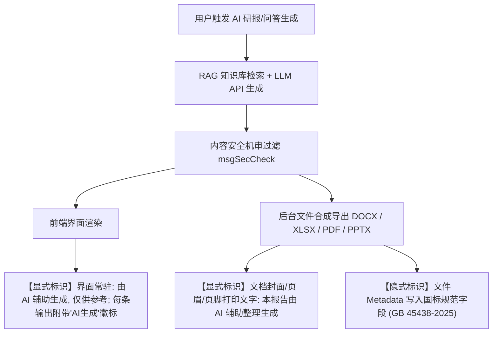
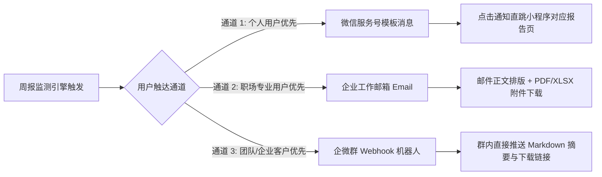
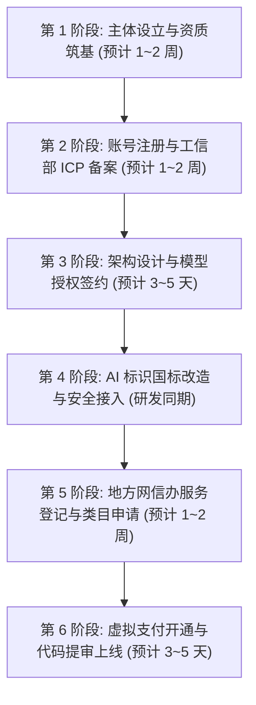

# 微信小程序「行业政策」（暂名）平台与合规可行性调研报告（2026年现行规则）

**调研基准日**：2026-09-25  
**调研定位**：商业与合规可行性核查（agy-A 专项）  
**核心结论先行**：
1. **个人主体走不通**：个人主体虽然开通了小额虚拟支付（限工具类，月限额 10 万），但**微信「深度合成/AI 问答」类目强制要求企业/组织主体**，个人主体无法合规上线核心 AI 问答功能，且无法开具 B 端发票，**必须注册企业主体（建议先个体工商户或小规模纳税人有限公司）**。
2. **暂定名「行业政策」存在重大驳回风险**：“政策”二字极易被微信审核判定为触碰“时政信息”，要求提供民营企业不可能获得的《互联网新闻信息服务许可证》；**必须更名为偏向“企服工具/申报助手/数据检索”的名称（如「企策查」「研报罗盘」）**。
3. **生成式 AI 合规已全面常态化**：调用已备案大模型做 RAG，不需做底层大模型备案，但需办理**地方网信办“生成式人工智能服务登记”**；同时必须严格遵守 **2025-09-01 起正式施行的强制性国家标准 GB 45438-2025**，页面交互与导出的 Word/Excel/PDF/PPT 文件**必须同时具备显式水印标识与文件元数据（Metadata）隐式标识**。
4. **虚拟支付与 iOS 分成已落地**：卖会员与按次下载在微信体系下 100% 属于“虚拟支付”，自 2026 年起微信全面实行闭环，严禁外部导流；iOS 端通过苹果小程序合作伙伴通道扣除 **15%** 佣金，安卓/鸿蒙扣除 **1%** 技术服务费；B 端团队版（¥799–1999/月）应走**线下对公转账+合同发票+后台激活码**，合法避开苹果税并满足企业报销需求。
5. **每周监测提醒无法仅靠小程序完成**：小程序“长期订阅消息”仅向政务民生、医疗、交通等公共类目开放，商业小程序只有“一次性订阅”；**必须采用「小程序 + 微信服务号模板消息」或「邮件周报（Email）」双轨驱动**。

---

## 核心总表：微信平台能力与合规规则全景矩阵

| 能力 / 环节 | 规则要点（2026年现行） | 官方/一手来源链接与日期 | 对本项目的影响 | 建议做法 |
| :--- | :--- | :--- | :--- | :--- |
| **1. 主体与备案** | • 个人主体可做基础工具但不可申请 AI 深度合成类目；<br>• 所有境内小程序必须完成工信部小程序 ICP 备案；<br>• 企业主体（个体户/有限公司）方可解锁深度合成与完整商业化能力。 | • 工信部《关于开展移动互联网应用程序备案工作的通知》（2023-08-08 发布，2024-04 严打常态化）<br>• [微信官方开放平台主体类目指引](https://developers.weixin.qq.com/)（2026 年） | **致命阻断**：个人主体无法上线 AI 问答，也无法满足 B 端企业用户开专票报销需求。 | 注册**个体工商户**（成本极低）或**一人有限责任公司**，以企业主体注册小程序、申请企业微信认证及办理小程序 ICP 备案。 |
| **2. 服务类目与模型调用** | • AI 问答必须申请「深度合成-AI问答」类目；<br>• 调用第三方模型需提交服务商的《算法备案》证明与《合作协议》；<br>• 签约主体与算法备案主体必须严格一致。 | • 国家网信办《互联网信息服务深度合成管理规定》（2023-01-10 施行）<br>• [互联网信息服务算法备案系统](https://beian.cac.gov.cn/) | 若直接上线 AI 问答而无对应类目，代码审核会被直接驳回并可能被封禁搜索能力。 | 选用已备案主流大模型（如通义千问、火山引擎豆包、腾讯混元），在云厂商控制台直接导出《小程序上架专用算法授权书及合作协议》，挂载加盖公章提交。 |
| **3. 生成式 AI 与标识标准** | • 纯 API 调用+RAG 属应用层，免去底层安全评估，但需在属地网信办完成**服务登记**；<br>• 强制性国标 **GB 45438-2025**（2025-09-01施行）：页面显式标明 AI 生成，导出文件必须写入元数据（隐式）与显式提示。 | • 国家网信办等四部门《人工智能生成合成内容标识办法》（2025-09-01 施行）<br>• 强制性国标 [GB 45438-2025《网络安全技术 人工智能生成合成内容标识方法》](https://samr.gov.cn/)（2025-02-28 发布，2025-09-01 施行） | 导出的 Word/Excel/PDF 若无元数据标识，属于违规；若未做属地网信办登记，存在被通报整改风险。 | 交互界面显著展示“AI生成提示”；Python 导出模块（openpyxl/python-docx/reportlab）强制写入国标元数据字段与文件尾部提示；向属地网信办提交应用登记材料。 |
| **4. 收费与虚拟支付** | • 卖会员、查数据、按次导出报告 100% 属于**虚拟支付**，微信禁止走普通支付，禁止外链绕行；<br>• 2026 年 iOS 虚拟支付走苹果小程序合作计划，抽成 15%；安卓/鸿蒙技术服务费 1%。 | • [微信小程序虚拟支付接入指引](https://developers.weixin.qq.com/miniprogram/dev/platform-capabilities/business-capabilities/virtual-payment/person)（2026年）<br>• 微信官方关于虚拟支付全平台闭环规则（2026-04-01 全面执行） | 个人版/按次付费收益会被 iOS 扣减 15%；若尝试引导微信个人收款码，面临直接下架封号。 | C 端与个人版接入官方 `wx.requestVirtualPayment`；**B 端团队版（¥799–1999/月）采用“企业咨询-线下合同-对公转账-开具发票-后台兑换码激活”**，完全合法规避苹果税。 |
| **5. 文件交付技术** | • 移动端通过 `wx.downloadFile` + `wx.openDocument(showMenu: true)` 预览与保存，或 `wx.shareFileMessage` 发给好友；<br>• PC 端专属 API `wx.saveFileToDisk` 支持直接“另存为”；<br>• 微信端单文件建议控制在 10MB 内（上限 50MB/存储空间 200MB）。 | • [微信官方文档-文件接口 wx.openDocument / wx.saveFileToDisk](https://developers.weixin.qq.com/) | 报告导出若过大在手机端易闪退（OOM）；职场人核心痛点在 PC 端处理文件。 | 移动端提供“发到微信聊天”，PC 端调用 `wx.saveFileToDisk` 弹窗另存为；同时提供“复制电脑下载链接”作为跨端兜底。单文件严格压缩在 10MB 内。 |
| **6. 消息提醒与监测** | • **长期订阅消息仅限政务民生等非营利类目**，商业工具类目无法开通；<br>• 一次性订阅消息授权 1 次只能发 1 条，无法支撑 52 周自动推送。 | • [微信官方小程序订阅消息规范](https://developers.weixin.qq.com/)（2025–2026年现行规则） | 原型中“每周自动监测推送到微信”若单靠小程序技术，完全不成立。 | 采用**三轨推送策略**：① 微信服务号模板消息（核心触达）；② 邮件周报（B端/办公人群刚需，送达率极高）；③ 小程序内红点站内信。 |
| **7. 内容安全与时政防范** | • 提供政治、经济、法律等公共事务报道需《互联网新闻信息服务许可证》；<br>• 严禁碰“时政新闻、政策独家解读、领导人动态”；<br>• 微信端必须接入文本内容安全过滤。 | • 国家网信办《互联网新闻信息服务管理规定》（国家网信办令第1号）<br>• 微信小程序名称与内容审核规范 | 暂定名「行业政策」及“政策库”定位极高概率被机审识别为“时政信息”而被要求提供新闻资质。 | 更名为「企策查」「研报罗盘」等；定位为“企业申报指南与公开政务目录索引工具”；接入微信 `security.msgSecCheck` 接口对 Prompt 和生成内容实时过滤。 |

---

## 逐项关键合规与规则深度调研

### 1. 主体与小程序 ICP 备案要求

#### (1) 个人主体 vs. 企业主体的鸿沟
*   **个人主体限制**：虽然微信在 2024–2025 年为个人主体开通了虚拟支付（限于工具类目，月限额 10 万元），但是**「深度合成 - AI问答」类目未向个人主体开放**。只要小程序内包含自由对话的 AI 问答框，个人主体在提交代码审核时就会被系统拦截，提示：“当前页面功能涉及深度合成技术，请补充对应企业服务类目”。
*   **个体工商户 vs. 有限公司**：
    *   **个体工商户**：可顺利完成企业微信认证（300元/年），可开通深度合成类目，可申请开通虚拟支付及微信支付，可注册微信服务号。成本低，记账报税简易。缺点是对外商业信誉稍逊，部分政企采购可能对个体户有供应商准入限制。
    *   **有限责任公司（推荐）**：具备完整的独立法人资格，可开具 1% 或 13% 的**增值税专用发票**（B 端企业客户采购报销的刚需）。对于定价 ¥799–1999/月的团队版以及企业定制版，企业采购必须走公对公与专票报销，有限公司是商业闭环的唯一选择。

#### (2) 小程序 ICP 备案实施细则
*   依据工信部 2023 年 8 月印发并在 2024 年 4 月进入常态化监管的《关于开展移动互联网应用程序备案工作的通知》：
    *   **办理路径**：开发者无需单独跑通信管理局网站，统一在微信公众平台后台提交备案申请，微信平台核验后代报至企业注册地省级通信管理局。
    *   **审核周期**：腾讯初审 1~2 个工作日，省管局短信核验+终审通常 1~7 个工作日（法定上限 20 个工作日）。
    *   **备案必备材料**：企业营业执照原件彩色扫描件、法人及小程序负责人身份证、小程序负责人人脸核身、前置审批资质（如涉及特殊行业；纯申报信息查询工具无需前置审批）、真实性承诺书。

---

### 2. 服务类目与大模型 API 调用资质要求

#### (1) 类目选择策略
*   **主营基础类目**：建议选择 `IT科技 - 软件与综合信息服务` 或 `工具 - 信息查询`、`企业服务 - 软件/建站/技术开发`。切勿选择带有“新闻”、“资讯-时政”类目。
*   **AI 核心类目**：必须添加 **`深度合成 - AI问答`**（在微信小程序后台“服务类目”中选择）。

#### (2) 调用第三方大模型 API 的提交材料
微信审核深度合成类目遵循网信办《互联网信息服务深度合成管理规定》，对第三方模型调用的审核要点极其严苛，核心材料如下：
1.  **大模型算法备案证明**：提供模型厂商在国家网信办“互联网信息服务算法备案系统”（`beian.cac.gov.cn`）中的备案公示截图（须带有清晰的“网信算备xxxxxxxx号”，算法类型明确为“生成合成类”或“深度合成”）。
2.  **技术合作协议与授权函**：
    *   提供小程序主体与模型提供商签署的采购合同/服务协议。
    *   **高频驳回避坑点**：协议中的**签约主体必须与算法备案主体一致**，或有清晰的隶属/全资子公司证明。例如，若使用火山引擎（豆包），合同主体通常为“北京火山引擎科技有限公司”，而算法备案主体多为关联公司，开发者需直接在云厂商控制台的“上架合规/资质中心”直接下载平台预置的《小程序上架专用算法授权书（带章）》，该文件已理顺授权链条，微信官方认可度最高。
3.  **大模型上线状态**：选用的第三方模型必须已通过国家网信办生成式人工智能服务上线备案（如通义千问、DeepSeek、智谱 GLM、火山豆包等均已完备）。

---

### 3. 生成式 AI 合规与国家标准（GB 45438-2025）落地要求

#### (1) 应用层 RAG 是否需要“模型备案”？
*   **明确界限**：根据《生成式人工智能服务管理暂行办法》及 2024–2026 年各省市网信办实务标准，**单纯通过 API 调用已备案基座模型、仅利用 RAG 检索增强技术外挂私有知识库，而未对模型权重进行实质性再训练（Fine-tuning）的应用，不需要做研发侧的“生成式人工智能大模型安全评估备案”**。
*   **地方“生成式 AI 服务登记”**：
    *   截至 2026 年，北京、上海、广东、山东等主要省市网信办均已上线简化版的**“生成式人工智能服务上线登记/备案”**系统（如上海的“模速空间”窗口、广东及山东省网信办登记入口）。
    *   **做法**：在小程序面向公众提供服务前，向注册地网信部门提交《服务上线登记表》，报备：产品名称、使用场景、调用的已备案模型名称及备案号、合作协议、内容安全审核措施及敏感词过滤机制。

#### (2) 《标识办法》与强制性国家标准 GB 45438-2025 实施细节
《人工智能生成合成内容标识办法》与配套强制性国标 **GB 45438-2025《网络安全技术 人工智能生成合成内容标识方法》已于 2025 年 9 月 1 日起正式施行**。本项目涉及“页面生成”与“导出文件”，必须同时满足**显式标识**与**隐式标识**：



*   **页面显式标识要求**：
    *   在小程序对话页面输入框上方或初始欢迎语中，必须有持久可见的提示语：“本功能由人工智能生成合成技术提供，内容仅供参考，不构成法定依据”。
    *   每一个由 AI 生成的对话气泡或卡片，必须附带显著的“AI生成”或“深度合成”图文徽标。
*   **导出文件（Word / Excel / PDF / PPT）国标要求**：
    1.  **显式内容标识**：在导出的 DOCX/PDF 封面、页眉或页脚处，以及 XLSX 表格的底部说明行中，明确标注“本文件内容由 AI 自动生成整理，请以官方原始公告为准”。
    2.  **文件元数据（Metadata）隐式标识**：
        *   GB 45438-2025 明确要求服务提供者在导出文件元数据中嵌入标准化字段。在 Python 后台生成文件时，必须通过代码在核心属性（Core Properties）中注入：
            *   `Creator / Author`：小程序官方服务名称（如 `EnterprisePolicyCompass`）。
            *   `Subject / Description`：`AI-Generated Content; Model: Qwen/DeepSeek; AlgorithmRegNo: 网信算备xxxxxxxx号`。
            *   `Keywords / Tags`：`AIGC; Synthesized; GB45438-2025`。
            *   `Custom Properties`：写入唯一生成任务 ID（TraceID），以便于溯源核查。

---

### 4. 收费模式与虚拟支付规则（2026年现行）

#### (1) 业务性质定性：100% 属于虚拟支付
*   在微信生态中，凡是购买**非实物、数字化交付、无需实体物流发货**的内容（包括：会员时长、单次报告导出配额、企业名录解锁、AI 提问次数），全部被微信官方严格界定为**“虚拟商品/虚拟支付”**。
*   **严打绕行**：自 2025 年末至 2026 年（微信 2026-04-01 全平台强制执行），微信严厉打击通过“普通微信支付（实物商品模式）”、“客服消息发送购买二维码”、“跳转外部 H5 链接或网页”进行收款的行为。一旦被监测到，直接面临拦截支付接口乃至小程序全网下架。

#### (2) 2026 年微信小程序虚拟支付现行规则与分成
微信已正式接入苹果的“小程序合作伙伴计划”（Mini Apps Partner Program），在 iOS 端实现了合规的内购通道：
*   **iOS 端**：
    *   必须接入官方 `wx.requestVirtualPayment` API。
    *   **苹果分成比例**：符合小型企业标准的开发者，苹果收取 **15%**（相较于传统 App Store 30% 已减半）；
    *   **腾讯技术服务费**：微信官方在推广期对 iOS 端多采取阶段性让利（通常为 0%~5%），扣除苹果抽成后结算给开发者。
    *   **账期与结算**：iOS 端因经过苹果结算链条，回款周期通常为 **45~60 天**。
*   **安卓 / 鸿蒙 / Windows 端**：
    *   走微信自有虚拟支付通道，微信官方收取 **1%** 的技术服务费。
    *   结算周期较快（通常 T+1 至 T+7）。

#### (3) B 端团队版（¥799–1999/月）与企业定制的最佳实践
*   **企业客户痛点**：企业/机构采购（智库、企服公司、投资机构）不可能由员工用微信零钱直接支付并承担 15% 的苹果抽成，且企业财务报销必须要有**对公银行转账凭证**和**增值税专用发票**。
*   **合规操作方案**：
    1.  **小程序内展示**：小程序端针对团队版和企业版，仅展示功能特权，按钮设置为**「联系企业顾问 / 预约开通」**。
    2.  **线下/Web端交易**：销售团队与客户在线下或通过企业邮件签署《技术服务采购合同》，客户通过企业网银向创业者的公司对公账户电汇打款。
    3.  **财务开票**：公司为客户开具增值税发票，开票品目通常为“*信息技术服务*软件服务费”或“*信息技术服务*信息服务费”。
    4.  **权益交付**：运营人员在管理后台为该客户创建企业组织，或生成一组“团队专属企业激活码”，客户在小程序“我的 - 企业兑换”输入激活码，即可激活对应数量的员工席位与并发额度。
    *   *合规优势*：线下 B2B 合同履约完全脱离微信客户端虚拟支付范畴，不触犯平台规则，同时 100% 避免了 15% 的苹果佣金。

---

### 5. 跨端文件交付方案与技术边界

用户核心需求是将生成的 XLSX / DOCX / PDF / PPTX 导出并在电脑或手机上使用。微信生态内的具体实现路径如下：

#### (1) 移动端（iOS / Android）交付路径
1.  **首选方案：`wx.downloadFile` + `wx.openDocument` 预览与保存**
    *   后端生成文件并返回具有短时效防盗链的 HTTPS 下载 URL。
    *   前端调用 `wx.downloadFile` 将文件下载至小程序本地临时缓存。
    *   调用 `wx.openDocument({ filePath, fileType: 'xlsx', showMenu: true })` 打开系统原生阅读器。
    *   **关键配置**：必须传入 `showMenu: true`，此时页面右上角会展示“...”菜单，用户可直接点击“保存到手机”或“使用系统其他应用打开”。
2.  **最佳便捷方案：`wx.shareFileMessage` 直接发到微信聊天**
    *   在文件下载成功后，直接调用 `wx.shareFileMessage({ filePath, fileName: '2026青岛高新技术企业认定名单.xlsx' })`。
    *   系统直接弹出微信通讯录，用户可直接发给“文件传输助手”或同事群聊。用户在微信电脑端登录时，直接在聊天记录中即可接收并打开文件，体验最为丝滑。

#### (2) PC 端（Windows / Mac）微信小程序专属体验
*   职场人处理政策表格和撰写研报绝大多数在 PC 上完成。PC 微信小程序具备移动端没有的特有 API：
    *   **`wx.saveFileToDisk`**：在 PC 微信环境下，直接调用该接口，会**直接呼出 Windows 资源管理器或 Mac Finder 的“另存为”保存窗口**，用户可自由选择本地硬盘文件夹保存文件。
    *   **代码必须做环境检测**：
        ```javascript
        const systemInfo = wx.getSystemInfoSync();
        if (systemInfo.platform === 'windows' || systemInfo.platform === 'mac') {
          // PC 端首选：直接另存为磁盘文件
          wx.saveFileToDisk({ filePath: tempFilePath, ... });
        } else {
          // 移动端：调用预览或分享至聊天
          wx.shareFileMessage({ filePath: tempFilePath, fileName: '...' });
        }
        ```
*   **备用兜底：跨端一键复制链接**：
    *   提供“复制电脑下载链接”按钮，调用 `wx.setClipboardData` 复制带有时效 Token 的下载直链，用户在 PC 浏览器粘贴直接下载。

#### (3) 文件大小与格式硬性限制
*   `wx.openDocument` 支持格式：`doc, docx, xls, xlsx, ppt, pptx, pdf`。
*   **文件大小阈值**：虽然网络下载理论上限更高，但小程序本地单用户存储配额通常为 **200MB**，且移动端内存受限，**单文件若超过 20MB 极易触发内存溢出（OOM）导致微信闪退崩溃**。建议后端生成的文档和表格严格控制在 **10MB 以内**（纯文字和数据表格通常小于 2MB，若包含图表，须进行图片压缩处理）。

---

### 6. 消息提醒机制与每周监测的破局方案

#### (1) 小程序订阅消息的规则硬伤
*   **长期订阅消息（无限制推送）**：
    *   **准入范围**：目前仅向**政务民生、医疗、交通、公共教育、金融机构**等特殊公共服务主体开放，且要求严格的行政许可资质。
    *   **现状**：普通企业主体、商业软件类目**绝对无法开通长期订阅**。
*   **一次性订阅消息（1次授权 = 1条推送）**：
    *   用户在小程序内主动点击勾选授权 1 次，开发者后台仅能发送 1 条模板消息。即便勾选“总是保持以上选择”，也仅是下次触发授权时不弹窗，**额度依然是消耗性的，不会自动生成无限额度**。
    *   **影响**：原型中设计的“每周自动监测更新并微信推送周报”，在单纯的小程序环境下**技术与合规均不成立**，用户无法在不登录的情况下被连续通知 52 周。

#### (2) 破局替代方案对比



1.  **方案 A（最佳生态实践）：微信服务号 + 模板消息**
    *   注册同主体的**微信服务号**，并在微信开放平台与小程序绑定，实现统一的用户 `UnionID` 体系。
    *   小程序内引导用户关注服务号（完成绑定）。服务号在合规业务触发下，可在周一上午通过服务号模板消息向用户推送更新提醒，**用户点击服务号通知即可直接唤起并跳转到小程序的特定研报页面**。
2.  **方案 B（办公场景首选）：工作邮箱定时周报（Email Digest）**
    *   面向企业政策岗、投资研究岗等职场人群，**查阅 Outlook/企业微信邮箱是每周一早晨的标准工作流**。
    *   用户在小程序中订阅“青岛科技名单周报”并绑定企业邮箱；后端定时调度引擎每周一早 8:00 自动发送邮件，正文渲染 HTML 摘要，并**直接附带导出的 PDF 或 Excel 附件**。无需消耗微信接口额度，送达率极高且符合 B 端使用习惯。
3.  **方案 C（针对团队版）：企业微信/钉钉 Webhook 机器人**
    *   团队版客户可配置其内部工作群的 Webhook 地址，监测周报生成后直接推送到客户内部的政策研究群，形成团队级的信息交付。

---

### 7. 内容安全与政策/时政风险规避指南

#### (1) 为什么暂定名「行业政策」具有高风险？
*   根据《互联网新闻信息服务管理规定》第二条，凡是提供政治、经济、法律法规等社会公共事务的报道、评论，均属于“互联网新闻信息服务”。
*   在微信小程序名称审核与内容机审机制中，**“政策”、“时政”、“新闻”、“发布”、“内参”属于强监管敏感词**。若直接以「行业政策」作为小程序名称，极易在初审阶段收到驳回通知：“*小程序名称或内容涉及提供时政新闻/法规解读服务，需补充提供《互联网新闻信息服务许可证》*”。

#### (2) 规避与重新定位策略
1.  **名称与定位去“新闻化”，转向“工具化”**：
    *   **建议更名方向**：采用强调“检索、辅助、工具、企业服务”的名称，例如：**「企策查」「研报罗盘」「企策通助手」「产业申报罗盘」「数据搜搜」**。
    *   **业务描述定位**：对外官方介绍统一定义为“*面向企业的公开申报信息查询工具与行业公开资料整理软件*”，强调自身是**搜索引擎与数据整理工具**，而非新闻采编平台。
2.  **数据来源与呈现的合规处理**：
    *   严格保留“官方原始出处”超链接与原始发布时间，注明“信息来源于各地政府部门及行业协会公开门户网站”。
    *   **禁止进行主观情绪化或具有政治倾向的“评论/解读”**；AI 助手的输出必须严格基于检索到的官方原文，禁止 AI 发散未公开的“政策内幕”或“官方态度”。
3.  **接入微信内容安全接口**：
    *   小程序必须集成微信官方提供的文本安全审核接口 **`security.msgSecCheck`**。
    *   对用户输入的提问 Prompt 进行前置机审过滤；对大模型输出的研报内容在入库或展示前进行二次机审，拦截涉政敏感词、违法有害信息。

---

## 上线前合规落地时间表（按时间先后顺序）



### 第 1 阶段：主体设立与资质筑基（第 1–2 周）
*   [ ] **决定主体形式**：注册一人有限责任公司（推荐，便于开专票及 B 端合作）或个体工商户。经营范围需涵盖：“软件开发”、“信息技术咨询服务”、“技术服务、技术开发”。
*   [ ] **开设银行基本户**：取得开户许可证或基本存款账户信息（后续申请微信商户、企业微信认证、B端对公转账所必需）。
*   [ ] **确定避坑产品名**：放弃「行业政策」，确定 2–3 个备选品牌名（如「企策查」「研报罗盘」），查询商标与小程序重名情况。

### 第 2 阶段：账号注册与小程序 ICP 备案（第 2–3 周）
*   [ ] **注册小程序企业账号**：使用企业营业执照注册，并完成 300 元/年的微信认证。
*   [ ] **注册同名微信服务号**：同步完成认证，并注册微信开放平台开发者账号，将小程序与服务号绑定至同一开放平台（打通 UnionID）。
*   [ ] **完成小程序 ICP 备案**：在微信后台提交企业及法人资料，等待省通信管理局短信核验与审核（通常 1~5 个工作日通过）。

### 第 3 阶段：模型授权签约与类目筹备（第 3–4 周）
*   [ ] **采购合规第三方大模型**：选择阿里云千帆、腾讯混元或火山引擎（豆包），以企业主体名义注册开发者账号并签署正式线上采购/服务协议。
*   [ ] **获取算法备案资质包**：在云厂商后台下载加盖厂商公章的《大模型算法备案证明及小程序上架授权书》，确保备案主体与协议主体对应链条清晰。
*   [ ] **配置服务器合法域名**：在微信公众平台后台配置后端 API 域名、文件下载（`wx.downloadFile`）域名的合法白名单（必须支持 HTTPS）。

### 第 4 阶段：代码研发合规与 GB 45438-2025 改造（第 4–5 周）
*   [ ] **界面显式标识植入**：问答交互页面显著标注“AI生成，仅供参考”，每条回答挂载“AI”专属标签。
*   [ ] **导出文件元数据（Metadata）写入**：Python 导出脚本中集成元数据注入模块，将服务名、算法备案号、生成时间戳写入 DOCX、XLSX、PDF 的底层元数据。
*   [ ] **内容安全机审链路打通**：接入微信 `security.msgSecCheck` 接口，构建 Prompt 前置拦截与回答后置核验的双重风控。
*   [ ] **跨端文件交付接入**：移动端编写 `wx.shareFileMessage` 及 `wx.openDocument`；PC 端编写 `wx.saveFileToDisk` 另存为逻辑。
*   [ ] **邮件/服务号消息打通**：部署定时任务，搭建周报邮件发送机制与服务号模板消息推送逻辑。

### 第 5 阶段：网信办服务登记与小程序类目申请（第 5–6 周）
*   [ ] **地方生成式 AI 服务登记**：向企业属地网信办（如青岛市/山东省网信办）提交《生成式人工智能服务上线登记表》备案。
*   [ ] **小程序类目申请**：在微信公众平台后台添加主类目（`IT科技 - 软件与综合信息服务`）以及特殊类目（`深度合成 - AI问答`），上传厂商算法备案证明和合作协议。

### 第 6 阶段：虚拟支付开通与审核上线（第 6–7 周）
*   [ ] **开通虚拟支付**：在微信后台“支付与交易 - 虚拟支付”模块签署协议，申请虚拟支付商户号（OfferID），配置道具与价格档位。
*   [ ] **适配 iOS 虚拟支付 API**：前端接入 `wx.requestVirtualPayment`，屏蔽所有外部导流按钮与违规跳转提示。
*   [ ] **B 端企业版通道隔离**：团队版仅保留“咨询企业顾问”表单，严防在小程序内展示非微信官方支付渠道。
*   [ ] **提交代码全量审核**：提交审核时附带详细测试账号、功能操作录屏及数据来源说明（强调为政府公开信息检索），通过后正式发布上线。

---

## 不确定 / 待核实事项清单

1.  **地方网信办“登记”窗口的具体落地节奏**：
    *   *现状*：北京、上海、深圳、杭州对纯 API 调用 RAG 应用的“服务登记”有极其成熟的线上填报通道；各二线城市（如青岛）网信部门在执行层面对初创个人/小微企业应用登记的响应周期与具体核查要求（是否要求线下约谈演示）存在属地化差异，需在主体注册完成后第一时间致电属地网信办网络安全与信息化协调科核实。
2.  **大模型服务商授权合同的主体变更细则**：
    *   *现状*：主流大模型（如字节跳动豆包）技术由北京火山引擎销售，但算法备案主体可能为北京抖音信息服务有限公司。虽然微信已有针对主流云平台的白名单豁免机制，但具体提交审核时是否需要追加云厂商的“全资控股/关联方证明”，需在拉取火山引擎或阿里云官方授权书时与云厂商客服最新确认。
3.  **微信服务号模板消息行业政策动态**：
    *   *现状*：微信持续在规范服务号模板消息的滥用行为，严禁将其作为无针对性的营销下发。本项目利用服务号发送“每周监测更新”必须定义为纯粹的“用户自主订阅通知”（例如模板名称需选择：`服务进度通知` 或 `订阅内容更新提醒`），不可带有诱导分享或营销打折词汇，具体需根据服务号后台最新可选模板库进行匹配。
4.  **PC 端微信小程序保存超大文件的沙箱环境限制**：
    *   *现状*：Mac 版微信与 Windows 版微信对 `wx.saveFileToDisk` 的实现细节存在轻微差异（如个别低版本 macOS 上弹窗可能被系统权限拦截）。需在原型测试阶段准备真实的 Mac 和 Windows 双平台进行物理真机实测验证。
