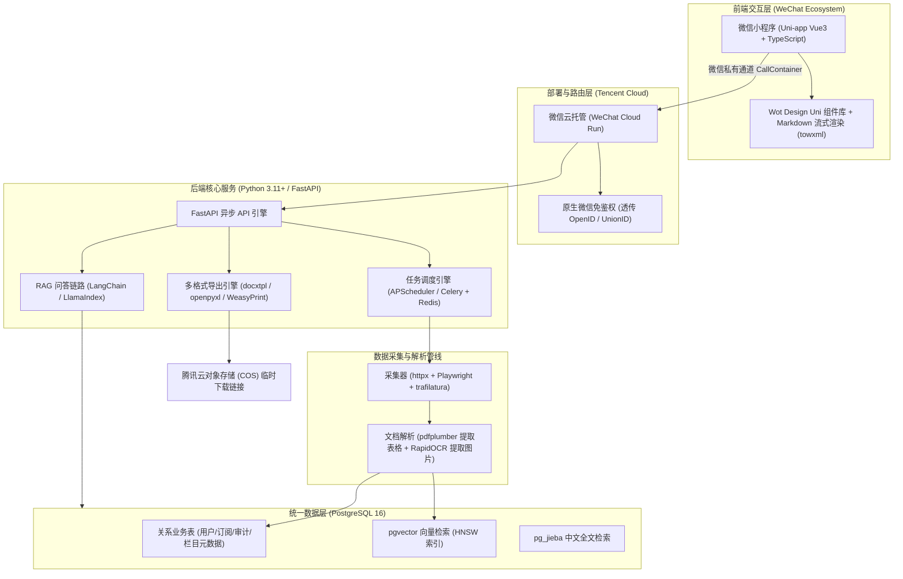

# 「行业政策」小程序数据源、法律版权与技术成本调研报告

**调研日期**：2026-09-25  
**调研团队**：agy-B（数据来源、法律合规与技术架构/成本）  
**核心结论先行**：
1. **数据源策略**：官方政策公报、企业公示名单（高企、专精特新、单项冠军）等属于公文与事实罗列，无版权障碍，但**严禁直接暴力破解抓取国家企业信用信息公示系统（GSXT）等高防系统**（触犯刑法红线），应优先采用“部委及省厅公示公告页抓取 + 地方公共数据开放网合规 API + 商业接口兜底”模式。
2. **法律安全岛**：政策原文、客观名单附件属于公有领域/无著作权客体；但**专家政策解读、政府委托第三方智库报告、商业研报**受完整著作权保护，必须坚持**“题录+短摘要+原站来源外链”**，坚决不做未经授权的“全文盗存、AI向量解析与直接下载”。涉个体工商户信息遵循“依法公开合理使用”原则，必须对手机号与身份证号脱敏。
3. **技术选型**：推荐**极简单体与 Python 一体化栈**——前端 `Uni-app (Vue 3 + TS)`，后端 `FastAPI (Python)`，数据库与向量检索引擎统一采用 `PostgreSQL 16 + pgvector`，结合 `WeasyPrint / docxtpl / python-pptx` 实现多格式高质量排版导出，首选部署于**腾讯云·微信云托管（WeChat Cloud Run）**，实现微信生态免鉴权与分钟级按量计费。
4. **成本结论**：得益于 2025–2026 年大模型推理与上下文缓存（Context Caching）的大幅降价，**MVP 阶段（1–3 个月）月支出仅需 ¥150～¥350**；在 1,000 名活跃用户、每周 20 次查询 + 2 次报告导出的规模化阶段，**全栈月度总成本控制在 ¥1,300～¥2,200 之间**，技术与算力成本极低，核心门槛在于数据清洗与合规运营。

---

## 一、 一手数据源清单（国家级与省级官方来源）

下表梳理了本项目首批可作为官方底座的数据源。按照官方性、更新规律与技术接入可行性进行分类整理：

| 机构与平台名称 | 官方 URL 与栏目 | 核心内容类型 | 典型更新频率 | 是否有公开 API / RSS / 下载 | 使用条款要点与反爬现实 | 采集与接入建议 |
| :--- | :--- | :--- | :--- | :--- | :--- | :--- |
| **中国政府网·政策库** | [gov.cn/zhengce](https://www.gov.cn/zhengce/) | 国务院文件、国办发文、部委规章、国务院公报、政策解读 | 工作日持续更新 | **无公开 API**；部分栏目有官方 RSS；支持按文号检索 | 明确版权归国办或信息提供单位所有；法定公文不受著作权保护；反爬较宽松，有基础 WAF | 首选源。针对列表页定期增量轮询（HTTP 304 / Last-Modified），解析正文与附件链接。 |
| **优质中小企业梯度培育平台**（工信部） | [zjtx.miit.gov.cn](https://zjtx.miit.gov.cn/) | 专精特新“小巨人”、专精特新中小企业、创新型中小企业认定公示与复核通知 | 批次性（年度集中集中公示 1–3 批） | **无公开 API**；提供公示名单 PDF/附件下载 | 官方政务服务平台，仅授权申报企业及监管使用，数据属于政务公示事实 | 重点监测通知公告栏。名单通常为 PDF/Excel 附件，抓取后通过本地脚本抽取。 |
| **工信部政务公开栏目** | [miit.gov.cn](https://www.miit.gov.cn/) | 制造业单项冠军示范企业名单、行业标准、产业政策 | 不定期（周度/月度） | **无公开 API**；有政务公开目录 | 官方版权声明，禁止用于歪曲和恶意商业诋毁 | 监控“司局子站”（产业政策与法规司、运行监测协调局）的公告公示。 |
| **全国高新技术企业认定管理工作网** | [innocom.gov.cn](https://www.innocom.gov.cn/) | 各省市高新技术企业拟认定公示名单、备案公告、证书批次 | 每月/季度批次发布 | **无公开 API**；支持按省份查询，提供公示批次 PDF 下载 | 统一身份认证平台；公示期通常为 10–15 个工作日，过期后转为备案库 | 建议以爬虫定时扫描各省公示栏目，下载 PDF 附件后做表格结构化抽取。 |
| **国家统计局·数据发布库** | [data.stats.gov.cn](https://data.stats.gov.cn/) | 月度、季度、年度宏观及行业统计数据、工业主要指标 | 按月/季度/年度定期发布 | **支持网页端多维度查询与 Excel 批量导出**；有数据接口协议但不对个人开放 | 统计公报与数据属于纯事实信息；网站有会话状态机制与请求频次限制 | 建立“指标元数据字典”，按月度自动化导出/解析标准化统计表格。 |
| **信用中国** | [creditchina.gov.cn](https://www.creditchina.gov.cn/) | 行政许可、行政处罚（双公示）、严重失信主体名单、经营异常 | 每日实时更新 | 仅提供单次网页查询与信用报告下载；**无对公免费商业 API** | 设较强反爬防御；公共信用数据供公众监督，严禁未经授权批量脱库 | **不建议直接高频抓取**。企业基础信用建议借助省市公共数据开放网或商业 API。 |
| **国家企业信用信息公示系统 (GSXT)** | [gsxt.gov.cn](https://www.gsxt.gov.cn/) | 工商基础登记、经营范围、年报、经营异常名录 | 实时变动 | **严禁外部爬取**；无对公众 API；仅对政务专网共享 | 配置极验滑动验证码、设备指纹风控、动态混淆加密，严禁批量爬取 | ⚠️ **坚决不要使用破解验证码爬取**（刑事高危）。必要工商字段从地方数据开放平台或第三方 API 获得。 |
| **国家发展和改革委员会** | [ndrc.gov.cn](https://www.ndrc.gov.cn/) | 产业结构调整指导目录、重点领域节能降碳专项、宏观政策 | 工作日更新 | **无公开 API**；有政务公开检索与分类聚合 | 官方政策文件，允许规范引用与公文传播 | 重点监测“发展改革委令”、“发展改革委公告”及“政策解读”栏目。 |
| **青岛市公共数据开放网**（地方试点代表） | [data.qingdao.gov.cn](https://data.qingdao.gov.cn/) | 地方企业信用、高企名单、专精特新名录、科技型中小企业 | 按季度/年度由部门汇聚更新 | **具备“API 服务”与“数据集下载”**（支持 CSV/JSON/XLSX） | 需实名注册企业/个人开发者账号，按需申请接口调用权限与授权协议 | **地方试点的首选合规源**。直接申请官方数据目录中的高企、专精特新等合规 API。 |
| **青岛市民营经济发展局 / 工信局** | [smb.qingdao.gov.cn](https://smb.qingdao.gov.cn/) / [gxj.qingdao.gov.cn](http://gxj.qingdao.gov.cn/) | 青岛市雏鹰企业、瞪羚企业、专精特新申报通知与认定公示 | 低频（全年约 20–30 次有效发文） | **无公开 API**；网页列表 + 附件（Word/Excel/PDF） | 地方政务网站标准声明，数据为政务通知 | 针对通知公告栏目做周度增量监控；印证了前期调研“52周中仅25周有新公告”的结论。 |

---

## 二、 法律边界深度剖析与合规红线

### 1. 《著作权法》第五条的适用边界分析
《中华人民共和国著作权法》第五条明确规定：“本法不适用于：（一）法律、法规，国家机关的决议、决定、命令和其他具有立法、行政、司法性质的文件，及其官方正式译文；（二）单纯事实消息；（三）历法、数通用表和公式。”

具体到业务中的四大类材料：
*   **企业认定名单附件（专精特新、高企、单项冠军等）**：
    *   **法律属性**：名单表格（企业名称、统一社会信用代码、认定类别、所属地域）属于对客观认定事实的记录与罗列，不具备独创性编排，**属于“单纯事实”与行政命令附件，不享有著作权**。
    *   **合规结论**：平台可以完全合规地抓取、入库、清洗、结构化呈现与导出。
*   **统计公报与宏观数据**：
    *   **法律属性**：国家或各级政府发布的《统计公报》属于行政机关履行法定职责发布的行政性文件（第五条第一项），其中记载的产值、增速、投资额等指标属于“单纯事实消息”（第五条第二项）。
    *   **合规结论**：统计公报数据不受著作权法保护，可自由引用入库。但注意：若第三方商业机构对统计数据进行了独创性的加工、加权分析或形成衍生图表，该汇编作品受保护。
*   **政府网站上的政策解读文章**：
    *   **官方公文配套解读（起草说明、部门答问、图解政策）**：若以国家部委或政府办公厅名义统一发布，通常被视为主体文件的附件或职权解释，独创性较低，司法实践中较少主张侵权；
    *   **特约专家/署名学者独立撰写的深度解读**：**不受第五条排除！** 属于受著作权法保护的“文字作品”。若未经授权在小程序内全文转载或提供全文下载，存在侵犯作者**信息网络传播权**的风险。
*   **政府委托第三方智库/高校编制的研究报告**：
    *   **法律属性**：依据《著作权法》第十九条，委托作品的著作权依合同约定；合同未明确约定的，**著作权属于受托人（第三方智库/机构）**。
    *   **合规结论**：政府购买服务完成的产业规划白皮书、行业研报**绝对不是行政公文，受完整著作权保护**！政府公开挂网仅是政务信息公开行为，绝不等于放弃版权或进入公共领域。商业产品未经授权绝不可全文存储、提供下载或灌入 AI 知识库做全文输出。

### 2. 抓取公开政府网站与企业白皮书的法律风险（2020–2026 年裁判趋势）

*   **反不正当竞争法（AUCL）的适用边界**：
    *   *政府网站*：政府机关不是《反法》第二条意义上的“市场经营者”，抓取政府网一般不直接适用反不正当竞争法；
    *   *商业平台与企业白皮书*：商业公司投入人力物力整理的行业数据库、券商研报库具有竞争性财产权益。2021–2025 年多起判例（如微梦创科诉脉脉案、大众点评诉百度案、企查查与天眼查系列纠纷）确立了**“实质性替代原则”**与**“过度损耗原网站系统资源原则”**。如果你把别人的独家白皮书全盘抓取并提供 AI 问答，用户无需访问原站，直接构成不正当竞争。
*   **刑法第 285 条“非法获取计算机信息系统数据罪”的红线**：
    *   **裁判关键**：核心审查是否**“避开或突破了计算机信息系统安全保护措施”**。
    *   *合规行为*：对公开静态网页、公开可见的 HTML/PDF 列表，以模拟正常浏览器低频访问（设置合理延迟、遵守抓取频率限制），**不构成侵入**。
    *   *犯罪行为*：如果目标网站（如 GSXT 或部分带盾平台）设有**极验滑动验证码、IP 频控封禁、Token 防盗链**，而你通过购买打码平台破解验证码、使用动态代理池暴力突破封禁、逆向破解 API 加密签名参数等方式强制抓取，在司法实践中（如最高检公布的爬虫侵入计算机系统典型案例）**一律被认定为“突破技术防护”**。一旦违法所得达 5,000 元以上或造成系统损失 10,000 元以上，即达到刑事立案追责标准。
*   **robots.txt 协议的效力**：
    *   根据中国司法实践（自“百度诉 360 违背 robots 协议案”起），robots 协议已被司法机关确认为**互联网行业公认的商业道德准则**。
    *   虽然违背 robots.txt 本身不单独直接入刑，但在民事诉讼中，违背 robots.txt 抓取商业内容会被直接认定为具备**主观恶意与违背诚实信用原则**，在反不正当竞争诉讼中基本必然败诉。

### 3. 商业研报与企业白皮书的使用与合作模式

| 运作模式 | 具体操作与形态 | 著作权与不正当竞争风险等级 | 法律分析与防范机制 |
| :--- | :--- | :--- | :--- |
| **模式 A：题录 + 摘要 + 原站链接（推荐）** | 展示研报标题、发布机构、发布日期、核心指标摘要（100–200 字以内的观点句），附带“前往原发布机构查看全文”按钮 | **低风险（合规安全区）** | 符合《著作权法》第二十四条第一款第二项“为介绍、评论某一作品或者说明某一问题，在作品中适当引用”。注意：摘要不得过长，绝不展示原报告的核心图表全文，绝不产生“实质性替代”；跳转链接需直接打开原网站页面（或引导复制浏览器打开），严禁通过 iframe 内嵌截流。 |
| **模式 B：全文存储 / AI 深度阅读 / 直接下载** | 将 PDF 研报直接下载存入本地/COS，切片灌入向量库做 RAG 全文交互，向用户提供 PDF 下载或完整导出 | **极高风险（侵权红线）** | 严重侵犯原作者或机构的**信息网络传播权**。即使 AI 进行了总结，若用户通过问答可获取报告大部分独创性核心内容，原版权方取证极其容易，面临法定最高 500 万元的高额侵权赔偿。 |

*   **与发布方的常见授权合作模式**：
    1.  **企业/大厂白皮书“PR 传播授权”**：大厂（如腾讯云、阿里云、华为云等）发布的产业白皮书，核心诉求是品牌曝光与业务拓客。平台可设立“入驻/认证机构发布专区”，与公关/市场部签署《白皮书联合传播授权书》，免费获取合法分发与解读权。
    2.  **券商/咨询机构 API 代理合作**：如接入慧博资讯、万得（Wind）、朝阳永续等合规数据分发商的机构数据 API，按年费或调用量计费，合法调用摘要与结构化观点。
    3.  **线索交换（Leads 分成）**：对于小型咨询顾问公司，小程序为其研报提供精准展示，用户若需深度咨询或获取定制版，向原作者/机构导流销售线索，换取版权授权。

### 4. 企业名单涉及个体工商户姓名等与《个人信息保护法》
*   **法律界定**：依据《个保法》第四条，个人信息是以电子或者其他方式记录的与已识别或者可识别的自然人有关的各种信息。个体工商户以自然人从事经营，其经营者姓名、联系电话与身份证号属于个人信息范畴。
*   **合法公开的豁免**：依据《个保法》第十三条第六项及第二十七条，处理**“依法公开的个人信息”**（如市场监管部门公示的登记信息），在“合理范围”内处理**无需取得个人同意**。
*   **合规红线与防范措施**：
    *   *合规行为*：仅在企业荣誉名单中如实陈列“青岛市某某区某某商行（经营者：张某某）荣获某某奖项”，属于合理公示，完全合法；
    *   *违法行为*：将经营者姓名与手机号批量抓取，打包包装成“外呼拓客名单”、“精准营销线索”并提供导出牟利，严重超出行政公示目的，触犯《个保法》并可能触犯刑法第 253 条之一“侵犯公民个人信息罪”；
    *   **产品设计底线**：在小程序和导出表格中，对所有自然人经营者信息实行**敏感字段自动脱敏**（如：姓名显示为“王*”，手机号隐藏中间四位，家庭住址/身份证号直接剔除），**严禁提供手机号导出与外呼工具**。

---

## 三、 技术架构建议（面向个人/小团队极简高可用）

为避免个人/小团队陷入“微服务过多、语言分裂、维护复杂”的陷阱，架构必须奉行**“单一语言后端、一库多用、Serverless 优先”**的原则。

### 推荐技术栈清单与选型理由

| 架构层级 | 推荐技术栈 | 备选方案 | 选型理由与小团队适用性分析 |
| :--- | :--- | :--- | :--- |
| **小程序前端** | **Uni-app (Vue 3 + TypeScript + Vite)** | 微信原生 / Taro (React) | 1. 个人开发者对 Vue 3 学习曲线最平缓； 2. 结合 `Wot Design Uni` 提供现代高颜值 UI； 3. 配合 `towxml` 或 `mp-html` 支持 SSE 流式 Markdown 打字机效果； 4. 未来若需出 Web/H5/App 可无缝多端复用。 |
| **后端语言/框架** | **Python (FastAPI)** | Go (Gin) / Node.js (Nest) | 1. **全栈统一于 Python**：AI 框架（LangChain/LlamaIndex）、爬虫（Playwright/httpx）、文档处理（PDF/Word/Excel）天然由 Python 主导，避免双后端架构； 2. FastAPI 具备原生异步高并发能力、自带 Pydantic 类型校验与 OpenAPI 接口文档。 |
| **数据库** | **PostgreSQL 16 + pgvector 插件** | MySQL + Milvus/Pinecone | **极简核心：一库三用**。 1. 存储用户、订单、订阅等关系型数据； 2. 存储政策元数据 JSONB（灵活扩展不同部门属性）； 3. `pgvector` 存储 Policy Chunk 向量，百万级向量毫秒级检索，免去独立维护专用向量数据库的巨大运维成本。 |
| **全文/混合检索** | **PostgreSQL (pg_jieba) + pgvector (Hybrid)** | Elasticsearch / Meilisearch | 采用“稀疏检索（关键词分词匹配）+ 稠密检索（向量相似度）”的混合检索，通过 RRF（倒数排名融合）合并得分。初期单台 Postgres 即可支撑，无需引入沉重的 ES。 |
| **采集与调度** | **httpx (异步) + Playwright + APScheduler** | Scrapy + Celery + Redis | 1. 针对常规静态页面使用 `httpx`，对 JS 渲染页面（如地方政务公示）使用轻量 `Playwright` 截取； 2. 使用 `trafilatura` 智能提取正文与清洗； 3. 500 个栏目调度量不大，使用轻量异步任务队列 `ARQ` 或 `APScheduler` 即可定时运行。 |
| **文档与附件解析** | **pdfplumber + RapidOCR (ONNX)** | MinerU / PaddleOCR GPU 版 | 1. 企业名单通常是结构化 PDF 表格，`pdfplumber` 表格定位抽取能力极强，直接转为 DataFrame 入库； 2. 遇到扫描件采用 `RapidOCR`（基于 ONNXRuntime），在 CPU 上即可极速运行，无需租用昂贵的 GPU 服务器。 |
| **多格式导出引擎** | **XLSX**: `openpyxl` **DOCX**: `docxtpl` **PPTX**: `python-pptx` **PDF**: `WeasyPrint` | ReportLab / LibreOffice headless | 1. `docxtpl` 支持设计好高颜值的 Word 母版，直接用 Jinja2 标签填充 AI 分析结果； 2. `python-pptx` 直接基于 PPT 母版生成排版精美的行业简报； 3. `WeasyPrint` 用 HTML+CSS 直接转 PDF，排版控制远比底层绘图库轻松。 |
| **云部署产品** | **腾讯云·微信云托管 (WeChat Cloud Run)** | 腾讯云轻量服务器 (Lighthouse) / 阿里云 ECS | **小程序开发的杀手级产品**： 1. 小程序端使用 `wx.cloud.callContainer` 直接内网连通容器，**免域名备案、免配置 SSL 证书**； 2. **原生免鉴权**：微信自动在 Header 中注入用户 `X-WX-OPENID`，彻底省掉登录鉴权、Token 签发与刷新逻辑； 3. **按量计费与自动缩容**：低谷时节点可缩容至 0，无请求不收费，每月赠送基础免费额度。 |

---

## 四、 成本估算（2026 年最新价格基准）

### 1. 国内主流大模型 API 定价参考（2026 年 Q3）
2026 年国内模型 API 已进入“精细化运营与分层计费”时代，主流厂商均已标配**上下文缓存（Context Caching）**和**峰谷差异化定价**：

| 厂商与模型系列 | 推荐定位 | 输入价格（元/百万 Tokens） | 输出价格（元/百万 Tokens） | 缓存命中/谷值折扣 | 特性与选型建议 |
| :--- | :--- | :--- | :--- | :--- | :--- |
| **DeepSeek-V4.1-Flash** | 快速过滤、意图识别、简单问答 | ¥1.0～¥1.5 | ¥4.0～¥6.0 | 缓存命中降至 10%～20% | 性价比极高，适合承担 80% 的日常查询任务。 |
| **DeepSeek-V4-Pro / R1** | 深度综合报告生成、多政策交叉比对 | ¥4.5～¥9.0 | ¥14.0～¥27.0 | 谷值时段半价优惠 | 复杂逻辑推理与长文综合能力顶尖。 |
| **通义千问 (Qwen3.8-Flash)** | 实时问答、大批量处理 | ¥0.8 | ¥2.7 | 支持百炼上下文缓存 | 阿里云百炼平台，稳定性高，高并发表现优异。 |
| **通义千问 (Qwen3.7-Plus)** | 研报生成、结构化提取 | ¥2.0～¥6.0 (阶梯) | ¥8.0～¥24.0 | 阶梯定价 | 适合替代 Pro 模型进行中等复杂度的报告起草。 |
| **豆包 (Doubao-Lite)** | 路由分类、关键词提取 | ¥0.3 | ¥0.6 | 字节火山引擎极致低价 | 成本极低，适合做入库文档的清洗与初步打标签。 |
| **智谱 (GLM-5.3-Flash)** | 代码/表格生成、结构化解析 | ¥0.8 | ¥2.8 | 新用户多赠送额度 | 对中文政务公文结构理解准确度高。 |
| **月之暗面 (Kimi K3)** | 超长白皮书与整本规划精读 | ¥20.0 | ¥100.0 | 长文本无损上下文 | 单价较高，仅适合作为长篇专精研究的增值功能。 |
| **通用 Embedding (百炼/智谱)** | 文本向量化（1024 维） | **¥0.5 / 百万 Tokens** | - | - | 百万 Token 仅需 5 毛钱，成本基本可忽略。 |
| **通用 Reranker (硅基流动/百炼)**| 检索结果二次重排打分 | **¥1.0 / 百万 Tokens** | - | - | 用于保障“官方出处”精准度，每万次检索约 1～2 元。 |

---

### 2. 规模化阶段月度成本核算（测算基准：1,000 名活跃用户）

**业务量设定**：
*   用户规模：1,000 名活跃职场用户（MAU/WAU）。
*   用户提问：每人每周 20 次，每月合计：`1,000 × 20 × 4.33 ≈ 86,600 次查询/月`。
*   报告导出：每人每周 2 次，每月合计：`1,000 × 2 × 4.33 ≈ 8,660 次导出/月`。
*   数据源监测：500 个栏目，每日轮询，每月预计产生约 1,000 篇新政策/名单/白皮书增量入库。

#### ① 模型 API 费用估算
*   **日常问答（86,600 次）**：
    *   采取**模型分流路由**：80%（约 69,280 次）使用轻量 Flash 模型，单次输入 ~3,000 tokens（含检索 context + 命中缓存），输出 ~500 tokens。消耗：输入 207M tokens（按缓存折扣折合约 ¥100），输出 35M tokens（约 ¥105）。
    *   20%（约 17,320 次）疑难跨行业综合查询使用 Pro/Plus 模型。消耗：输入 52M tokens（约 ¥210），输出 10.4M tokens（约 ¥125）。
    *   *问答模型小计*：`¥100 + ¥105 + ¥210 + ¥125 ≈ ¥540 / 月`。
*   **报告综合生成与导出（8,660 次）**：
    *   单次报告由 Qwen-Plus / DeepSeek 生成结构化提纲与正文（平均输入 5,000 tokens，输出 2,000 tokens）。
    *   消耗：输入 43M tokens（约 ¥170），输出 17.3M tokens（约 ¥260）。
    *   *报告生成小计*：`¥170 + ¥260 ≈ ¥430 / 月`。
*   **Embedding & Rerank**：
    *   1,000 篇入库文档向量化（5M tokens ≈ ¥2.5）。
    *   86,600 次检索的向量化与 Top-20 Rerank 消耗（约 ¥100）。
    *   *检索小计*：`约 ¥105 / 月`。
*   **模型费总计**：`540 + 430 + 105 = ¥1,075 / 月`。

#### ② 云资源与基础设施费用估算
*   **计算算力（微信云托管）**：采用 2 个 2C4G 容器实例进行弹性和负载均衡，平均运行利用率 30%～50%，夜间自动缩容至单节点。费用约 **¥220～¥350 / 月**。
*   **云数据库（PostgreSQL 16 托管版）**：2C4G 规格，50GB SSD 存储，备份与 WAL 归档。费用约 **¥220～¥280 / 月**。
*   **对象存储 COS + CDN 下行流量**：8,660 次报告下载（每次 500KB～2MB，共约 12GB 流量）+ 原始 PDF 存储 50GB。费用约 **¥25～¥45 / 月**。
*   **云缓存（Redis 1GB）**：用于异步任务调度与上下文会话缓存。费用约 **¥35～¥60 / 月**。
*   **微信认证与域名杂费**：微信小程序企业认证年费平摊（¥30/月）+ 域名与 SSL（约 ¥10/月）。
*   **云资源小计**：`¥530～¥765 / 月`。

**1,000 活跃用户月度总成本**：`¥1,075（模型）+ ¥650（云资源平均）≈ ¥1,725 / 月`（区间：**¥1,600 ～ ¥2,100 / 月**）。

---

### 3. MVP 阶段 vs 规模化阶段成本对比表

| 成本类目 | MVP 阶段（前 1–3 个月，0–100 种子用户） | 规模化阶段（1,000 名活跃用户，高频问答与导出） | 成本控制与优化建议 |
| :--- | :--- | :--- | :--- |
| **大模型推理 API** | ¥30 ～ ¥80 / 月 | ¥900 ～ ¥1,200 / 月 | 严格开启 Prompt 上下文缓存（Context Caching），系统提示词与热门政策上下文可享 80% 折扣。 |
| **Embedding & Rerank**| < ¥5 / 月 | ¥80 ～ ¥120 / 月 | 仅对检索前 20 条候选集进行 Rerank；本地维护高频词索引。 |
| **后端容器/服务器计算** | ¥30 ～ ¥60 / 月（轻量 2C4G 或利用云托管免费额度） | ¥220 ～ ¥350 / 月 | 微信云托管配置“按使用量缩容”，凌晨无人访问时实例自动缩为 0。 |
| **数据库存储 (PG)** | ¥0（单机 Docker 自建）或 ¥80（轻量数据库） | ¥220 ～ ¥280 / 月（高可用托管版） | 单台 PG16 整合关系表、JSONB 与 pgvector，坚决不引入独立向量数据库。 |
| **对象存储与带宽 (COS)**| < ¥10 / 月 | ¥30 ～ ¥60 / 月 | 导出的 Word/Excel/PDF 设置 7 天自动销毁策略，不长期占用昂贵存储。 |
| **注册认证与域名基础费** | ¥30 / 年（个人版小程序暂无需认证费，企业版 ¥300/年） | ¥300 / 年平摊（约 ¥25/月） | 若暂不涉及在线微信支付，前期可用个体或团队资质测试。 |
| **月度综合成本** | **¥150 ～ ¥350 / 月** | **¥1,450 ～ ¥2,100 / 月** | **极低试错成本**，核心支出完全随业务量（Tokens）线性浮动。 |

---

## 五、 不确定 / 待核实事项清单

在进入正式工程实现前，建议团队与业务负责人核实以下事项：

1.  **微信小程序类目与支付资质（关键）**：
    *   *待核实*：个人主体小程序**不支持开通微信支付**，且若涉及“资讯”、“企业数据查询”等行业资质，个人主体极易被微信驳回。若按假设计划收取“¥29–79/次或会员费”，必须尽快办理企业或个体工商户营业执照完成认证，并确认小程序服务类目是否需要“增值电信业务经营许可证（ICP/EDI）”。
2.  **国家企业信用信息公示系统（GSXT）合规商业替代源价格**：
    *   *待核实*：项目若涉及企业基本工商画像（经营范围、注册资本、法定代表人），自建爬虫不可行。需核实天眼查/企查查 API、国家级数据交易所或官方征信机构的公开 API 价格包（通常商业工商查询单次调用在 ¥0.05～¥0.15 左右），评估是否纳入成本。
3.  **青岛公共数据开放平台 API 审批周期**：
    *   *待核实*：青岛公共数据开放网（[data.qingdao.gov.cn](https://data.qingdao.gov.cn/)）虽然开放了部分企业名单与科技项目 API，但通常要求实名注册的企业账号提交《公共数据利用申请表》与应用场景说明，需核实政务数据授权审批通常需要几个工作日。
4.  **大厂商业白皮书来源授权通道建立**：
    *   *待核实*：首批计划整合的“腾讯云产业互联网干货库”及各大机构白皮书，需核实能否通过其官网公开的版权联系邮箱获得“题录及外链导流”的书面确认，以消除未来被主张不正当竞争的隐患。
